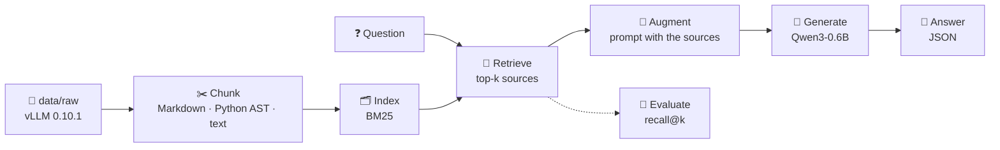
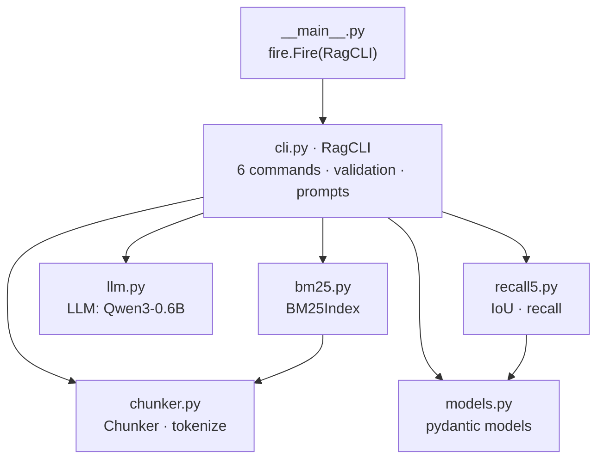
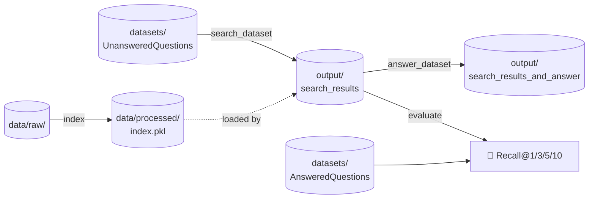
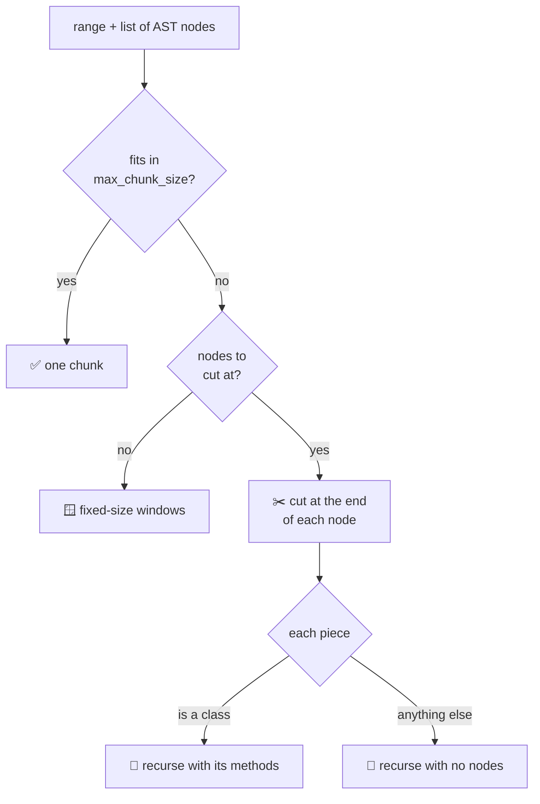
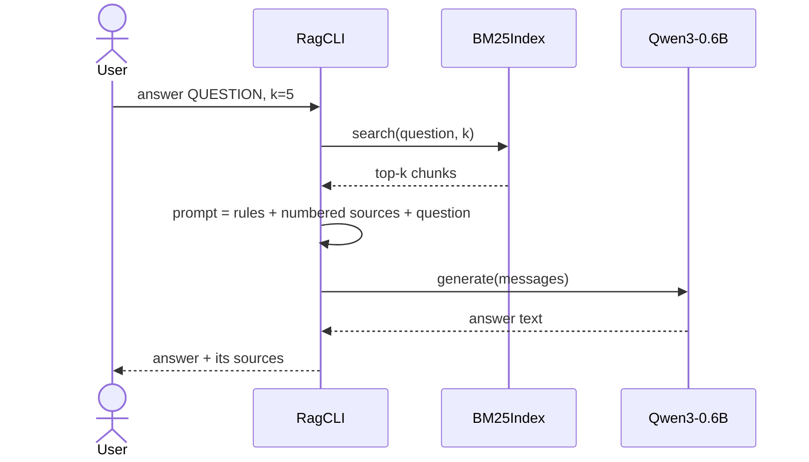

*This project has been created as part of the 42 curriculum by dvallada.*

<div align="center">

# 🤖 RAG against the machine

### *Will you answer my questions?*

A **Retrieval-Augmented Generation** system that answers questions about the
[vLLM](https://github.com/vllm-project/vllm) codebase: it indexes ~2,000 files,
finds the right snippets in milliseconds and lets a small local LLM answer from them.


</div>

---

## 📑 Table of contents

| | | |
|---|---|---|
| 📖 [Description](#-description) | 🚀 [Instructions](#-instructions) | 🧱 [System architecture](#-system-architecture) |
| 🧩 [Chunking strategy](#-chunking-strategy) | 🔎 [Retrieval method](#-retrieval-method) | 💬 [Answer generation](#-answer-generation) |
| 📊 [Performance analysis](#-performance-analysis) | 🧠 [Design decisions](#-design-decisions) | 🧗 [Challenges faced](#-challenges-faced) |
| 🧪 [Example usage](#-example-usage) | 📚 [Resources](#-resources) | |

---

## 📖 Description

A language model only knows what it saw during training. Ask it about a private
codebase and it will shrug, or worse, invent a confident answer.
**RAG** fixes that without retraining: before answering, the system **looks up**
the relevant pieces of a document collection and hands them to the model,
which then answers *from* them.

This project builds the whole pipeline over the **vLLM 0.10.1** repository
(1,969 files: 1,763 Python, 178 Markdown, 28 text, ~20 M characters):



| Stage | What it does here |
|---|---|
| **Indexing** | Splits every file into chunks of at most 2,000 characters (one strategy for Markdown, one for Python) and builds a BM25 index saved in `data/processed/`. |
| **Retrieving** | Scores every chunk against the question and returns the top-k as *source locations*: a file path and a character range. |
| **Augmenting** | Reads the text of those sources and builds a prompt with numbered sources and strict instructions. |
| **Generating** | Qwen3-0.6B writes a short answer grounded in the sources. |

**Results on the public datasets** — both above the required thresholds:

| | Recall@1 | Recall@3 | **Recall@5** | Recall@10 | Required @5 |
|---|:---:|:---:|:---:|:---:|:---:|
| 📘 **docs** questions | 0.620 | 0.800 | **0.840** | 0.860 | 0.80 ✅ |
| 🐍 **code** questions | 0.576 | 0.758 | **0.818** | 0.869 | 0.50 ✅ |

---

## 🚀 Instructions

### Requirements

| | |
|---|---|
| 🐧 OS | Linux or macOS |
| 🐍 Python | 3.10 or later (developed with 3.12) |
| 📦 Package manager | [uv](https://docs.astral.sh/uv/) |
| 💾 Disk | ~6 GB for the virtual environment (PyTorch) + ~1.5 GB for the model |
| 🎮 GPU | Optional: used automatically if CUDA is available, CPU otherwise |

### Installation

```bash
git clone git@github.com:DiegoVa6/RAG_against_the_machine.git
cd RAG_against_the_machine
make install          # same as: uv sync
```

The data is **not** in the repository. Put the files from the subject's
attachments here:

```
data/
├── raw/
│   └── vllm-0.10.1/              ← the vLLM repository (the corpus)
└── datasets/
    ├── AnsweredQuestions/        ← questions + their correct sources (ground truth)
    └── UnansweredQuestions/      ← questions only
```

> [!NOTE]
> The model (`Qwen/Qwen3-0.6B`) is **downloaded automatically** from Hugging Face
> the first time an `answer` command runs, and read from `~/.cache/huggingface`
> afterwards. Nothing else to set up.

### Commands

Every command runs as `uv run python -m src <command> [options]`
(add `--help` to any of them):

| Command | Options (default) | What it does |
|---|---|---|
| `index` | `--max_chunk_size` (2000), `--overlap` (10 %) | Chunks `data/raw/` and saves the index to `data/processed/index.pkl` |
| `search QUERY` | `--k` (5) | Prints the top-k sources for one question |
| `search_dataset` | `--dataset_path`, `--save_directory`, `--k` (5) | Searches a whole dataset → `StudentSearchResults` JSON |
| `answer QUERY` | `--k` (5) | Answers one question and shows its sources |
| `answer_dataset` | `--student_search_results_path`, `--save_directory` | Answers every question of a search file → `StudentSearchResultsAndAnswer` JSON |
| `evaluate` | `--student_search_results_path`, `--dataset_path` | Prints recall@1, @3, @5 and @10 against the ground truth |

### Full pipeline

```bash
# 1. Index the corpus (once)
uv run python -m src index --max_chunk_size 2000

# 2. Search a dataset (scope the output folder by dataset)
uv run python -m src search_dataset \
    --dataset_path data/datasets/UnansweredQuestions/dataset_docs_public.json \
    --k 10 \
    --save_directory data/output/search_results/UnansweredQuestions

# 3. Measure recall (our own evaluator, same numbers as the moulinette)
uv run python -m src evaluate \
    --student_search_results_path data/output/search_results/UnansweredQuestions/dataset_docs_public.json \
    --dataset_path data/datasets/AnsweredQuestions/dataset_docs_public.json

# 4. Generate the answers
uv run python -m src answer_dataset \
    --student_search_results_path data/output/search_results/UnansweredQuestions/dataset_docs_public.json \
    --save_directory data/output/search_results_and_answer/UnansweredQuestions
```

### Makefile

| Rule | Runs |
|---|---|
| `make install` | `uv sync` |
| `make run` | `uv run python -m src` (lists the commands) |
| `make debug` | the program under `pdb` |
| `make clean` | removes `__pycache__`, `.mypy_cache`, `.pytest_cache` |
| `make lint` | `flake8 .` + `mypy .` with the flags required by the subject |
| `make lint-strict` | `flake8 .` + `mypy . --strict` (optional) |

---

## 🧱 System architecture

### Modules



| File | Responsibility |
|---|---|
| `src/__main__.py` | Entry point: hands the `RagCLI` class to Python Fire, which turns each method into a command. |
| `src/cli.py` | The six commands. Validates every input first, reads and writes the JSON files, builds the prompts. |
| `src/chunker.py` | The three chunking strategies, the range merging step and the BM25 tokenizer. |
| `src/bm25.py` | Builds the BM25 statistics once and ranks chunks for a query. |
| `src/llm.py` | Loads Qwen with Hugging Face `transformers` and generates an answer from chat messages. |
| `src/models.py` | The pydantic models exchanged between stages (and written to disk). |
| `src/recall5.py` | IoU between character ranges and recall of one question. |

### How data flows between commands

Each command is a separate run of the program, so the stages talk **through files**:



| File | Written by | Read by | Content (pydantic model) |
|---|---|---|---|
| `data/processed/index.pkl` | `index` | `search*`, `answer*` | the `BM25Index` object: chunks + statistics |
| `UnansweredQuestions/*.json` | given | `search_dataset` | `RagDataset` |
| `AnsweredQuestions/*.json` | given | `evaluate` | `AnsweredDataset` (every question must have sources) |
| `search_results/…/*.json` | `search_dataset` | `answer_dataset`, `evaluate` | `StudentSearchResults` |
| `search_results_and_answer/…/*.json` | `answer_dataset` | — | `StudentSearchResultsAndAnswer` |

A **source** never stores text, only *where* the text is:

```json
{
  "file_path": "data/raw/vllm-0.10.1/docs/features/lora.md",
  "first_character_index": 4695,
  "last_character_index": 6100
}
```

---

## 🧩 Chunking strategy

A Markdown page and a Python file do not break apart the same way, so each
gets its own strategy. All three share the same guarantees:

> ✅ **Exact offsets** — the original text is never modified, chunks are `(start, end)` ranges of it.
> ✅ **Never above `max_chunk_size`** — the moulinette rejects any source longer than 2,000 characters.
> ✅ **Full coverage** — every character of every file belongs to a chunk.

### 📘 Markdown: recursive split by headings

The document is cut at its **biggest headings first**, and only the pieces that
are still too big are cut again at the next level:

````
# vLLM Guide                  ← level 1: only the title, no cut
## Install                    ┐
pip install vllm ...          │ fits → 1 chunk
## Usage                      ┤ too big → cut again at level 3
### Server                    ┤   → 1 chunk
### Client                    ┤   → 1 chunk
```bash                       │
# this is NOT a heading       │ ← lines inside ``` code blocks are ignored
```                           ┘
````

1. If the range fits in `max_chunk_size`, it is one chunk.
2. Otherwise, cut at the headings of the first level (`#` … `######`) found inside it, and recurse on each piece with the next level.
3. If no heading level is left, fall back to fixed-size windows with overlap.

### 🐍 Python: recursive split by AST nodes

Python's own parser (the standard `ast` module) gives the exact line where every
`class`, `def`, `import` or assignment starts and ends. The file is cut at the
**end of each top-level node**, so blank lines, comments and decorators always
travel with the code they describe:

```
  1 │ import os                        ◀── piece 1
  ──┼──────────────────────────────────  ✂  end of `import os`
  2 │
  3 │ X = 5                            ◀── piece 2
  ──┼──────────────────────────────────  ✂  end of `X = 5`
  4 │
  5 │ # adds two numbers               ◀─┐
  6 │ @decorator                       ◀─┤ piece 3: the comment and the decorator
  7 │ def add(a, b):                   ◀─┤ stay with the function
  8 │     return a + b                 ◀─┘
```



Line numbers are turned into character offsets with a table of where each line
starts (`find_line_starts`), so `ast` never needs byte or column offsets.

**Then, merge.** Cutting at *every* node creates a flood of tiny pieces (each
`import` alone, each constant alone…). A last pass joins **adjacent** pieces
while the result still fits:

```
before merge:  [import os][import re][import sys][X = 5][def small()][class Big ......]
after merge:   [import os  import re  import sys  X = 5  def small()][class Big ......]
```

| Python chunks (`max_chunk_size=2000`) | Without merge | With merge |
|---|---:|---:|
| Number of chunks | 41,150 | **12,820** |
| Chunks under 50 characters | 10,390 | **3** |

### 📄 Plain text: fixed-size windows

`.txt` files (and anything that cannot be parsed) are split into windows of
`max_chunk_size` characters, consecutive windows sharing `overlap` characters
(10 % by default) so a sentence cut at a border is still complete in one of them.

---

## 🔎 Retrieval method

### BM25

Every chunk gets a score for the question with **Okapi BM25**, and the top-k
are returned (chunks with score 0, i.e. no word in common, are dropped):

$$
\text{score}(q, c) = \sum_{t \in q} \text{IDF}(t)\cdot\frac{f(t,c)\,(k_1+1)}{f(t,c) + k_1\left(1 - b + b\,\dfrac{|c|}{\text{avgdl}}\right)}
\qquad
\text{IDF}(t) = \ln\!\left(\frac{N - n(t) + 0.5}{n(t) + 0.5} + 1\right)
$$

| Symbol | Meaning | In plain words |
|---|---|---|
| $f(t,c)$ | how many times term $t$ appears in chunk $c$ | repeating a word helps… |
| $k_1 = 1.5$ | saturation | …but less and less |
| $\lvert c \rvert$, avgdl, $b = 0.75$ | chunk length, average length, normalization | long chunks don't win just by being long |
| $N$, $n(t)$ | number of chunks, chunks containing $t$ | **rare words weigh a lot**, common words almost nothing |

All the statistics (term counts, lengths, IDF) are computed **once** by `index`
and saved with `pickle`; a search only reads them (≈ 25 ms per question).

### The tokenizer: where most of the recall comes from

> *"Questions and source code rarely use the same words: a question may
> paraphrase an idea or quote an identifier verbatim."* — the subject

BM25 only matches **identical** terms, so what the tokenizer produces decides
what can match. Three changes made the difference:

| # | Change | Why |
|:---:|---|---|
| 1 | **Index the file path** with the text | `vllm/model_executor/layers/sampler.py` brings *model, executor, layers, sampler*: words that questions use but the chunk text often doesn't. Only the indexed terms change; `chunk.text` and the offsets stay exact. |
| 2 | **Split identifiers** (`snake_case`, `CamelCase`) while keeping the whole word | A question says *"load a LoRA adapter"*, the code says `load_lora_adapter`. Now both match, and quoting the identifier verbatim still works. |
| 3 | **Drop stopwords** (*the, how, what, does, vllm*…) | They appear in nearly every question and chunk and only add noise. Only BM25 sees this list: the LLM (and a future embedding model) get the full text. |

| Text | Before | After |
|---|---|---|
| `How do I load a LoRA adapter?` | how · do · i · load · a · lora · adapter | i · load · lora · lo · ra · adapter |
| `def load_lora_adapter(self, request):` | def · load_lora_adapter · self · request | def · load_lora_adapter · **load · lora · adapter** · self · request |
| `class FusedMoEActivationFormat` | class · fusedmoeactivationformat | class · fusedmoeactivationformat · **fused · mo · e · activation · format** |

The CamelCase split is one regular expression, tried left to right:

```
[A-Z]+(?=[A-Z][a-z])  |  [A-Z]?[a-z]+  |  [A-Z]+  |  \d+
 acronym before a word    normal word     acronym    number
 HTTPServer → HTTP        Server, get     LLM, E     2
```

---

## 💬 Answer generation



The prompt separates **how to answer** (the `system` message, the same for every
question) from **what to answer** (the `user` message):

```
┌─ system ─────────────────────────────────────────────────────────────┐
│ You are an assistant that answers questions about the vLLM codebase. │
│ Answer using only the information in the numbered sources of the     │
│ context. Be concise and quote exact names (functions, classes,       │
│ flags, endpoints) as they appear in the sources. If the context does │
│ not contain the answer, say that you could not find it in the        │
│ sources.                                                             │
└──────────────────────────────────────────────────────────────────────┘
┌─ user ───────────────────────────────────────────────────────────────┐
│ Context:                                                             │
│ [1] data/raw/vllm-0.10.1/docs/features/lora.md                       │
│ ...text of source 1...                                               │
│ [2] data/raw/vllm-0.10.1/vllm/plugins/lora_resolvers/README.md       │
│ ...text of source 2...                                               │
│ Question: What HTTP endpoint is used to dynamically load a LoRA ...  │
└──────────────────────────────────────────────────────────────────────┘
```

| Setting | Value | Why |
|---|---|---|
| Model | `Qwen/Qwen3-0.6B` | Mandatory model; loaded by its Hugging Face name so `uv sync` is enough. |
| Context budget | 8,000 characters (≈ 2–4k tokens) | Sources are added best first until the budget is full. The model accepts 40,960 tokens, but on a CPU a long prompt is slow and a 0.6B model gets lost in noise. |
| Thinking mode | off (`enable_thinking=False`) | Short, direct answers. |
| `max_new_tokens` | 512 | A ceiling, not a target: generation stops at the end of the answer. With 100, long answers were cut mid-sentence. |
| Device | GPU if available, else CPU | Automatic. |

In `answer_dataset` the model is **loaded once** before the loop, each source's
text is read back from disk with its offsets (each file read only once thanks
to a cache), and a failure on one question doesn't lose the others.

---

## 📊 Performance analysis

### Recall

```
              0.0       0.5   0.8 1.0
              ├─────────┼─────┼───┤
docs   R@5    █████████████████░░░  0.840   ✅ needs 0.80
code   R@5    ████████████████░░░░  0.818   ✅ needs 0.50
```

`evaluate` reproduces the moulinette exactly (a correct source counts as found
when a result is in the same file with an IoU above 0.05; recall is the share
of a question's correct sources found, averaged over questions):

| | R@1 | R@3 | R@5 | R@10 |
|---|:---:|:---:|:---:|:---:|
| docs — `evaluate` | 0.620 | 0.800 | 0.840 | 0.860 |
| docs — moulinette | 0.620 | 0.800 | 0.840 | 0.860 |
| code — `evaluate` | 0.576 | 0.758 | 0.818 | 0.869 |
| code — moulinette | 0.576 | 0.758 | 0.818 | 0.869 |

### How we got there

Every change was measured before being kept (recall@5):

| Step | docs | code | |
|---|:---:|:---:|---|
| Markdown & text only (heading chunker) | 0.87 | — | code not indexed yet |
| + index the `.py` files (fixed windows) | 0.80 | 0.49 | code now competes with docs |
| + Python AST chunking | 0.76 | 0.37 | 📉 thousands of tiny chunks |
| + merge adjacent pieces | 0.79 | 0.52 | |
| + file path terms | 0.77 | 0.58 | |
| + identifier splitting | 0.79 | **0.82** | 🚀 +0.24 on code |
| + stopwords | **0.84** | **0.82** | ✅ both thresholds passed |

<sub>The first two rows used 1,000-character chunks, the rest 2,000. The first three
rows were measured with an early script that only checked each question's first
correct source; the following ones with `evaluate`.
Two other ideas were tested and dropped: tuning BM25's `k1`/`b` and merging
small Markdown sections, neither beat the final setup.</sub>

### Effect of the chunk size

| `max_chunk_size` | Chunks | docs R@5 | docs R@10 | code R@5 | code R@10 | Search, 100 questions |
|---:|---:|:---:|:---:|:---:|:---:|---:|
| **2000** | 14,105 | **0.84** | 0.86 | **0.818** | 0.869 | **3.0 s** |
| 1500 | 18,357 | 0.83 | 0.87 | 0.778 | 0.879 | 3.5 s |
| 1000 | 26,641 | 0.84 | 0.86 | 0.778 | 0.879 | 4.6 s |
| 500 | 50,557 | 0.83 | 0.84 | 0.808 | 0.889 | 7.6 s |

- **docs barely moves**: Markdown is cut at headings first, so chunks follow the sections whatever the limit.
- **code is best at 2000**: a whole function (name, docstring, body) stays in one chunk, so more of the question's words land in the same place. Smaller chunks spread that evidence; recall@10 rises a little because more distinct regions fit in the top 10.
- **Large chunks are not penalized** by the IoU threshold of 0.05: a 2,000-character chunk still counts for any correct span longer than 100 characters that it contains (the median correct span in the code dataset is ~880).
- **Smaller chunks are slower**: more chunks to score for every question.

→ **2000 is the default**: best recall@5 and the fastest search.

### Speed

| Operation | Measured | Subject limit |
|---|---:|---:|
| `index` — 1,969 files, ~20 M characters → 14,105 chunks | **~4 s** | 5 min |
| `search_dataset` — 199 questions (docs + code), index loading included | **~6.4 s** | 90 s for 200 |
| Model loading (after the first download) | ~2 s | — |
| One answer — GPU (RTX 4060 Laptop) | ~0.9 s | — |
| One answer — CPU only (i9-14900HX) | ~13.5 s | — |

### Answer quality

- When the correct source is retrieved, answers are short and match the reference closely
  (e.g. *"vLLM sets the `linear_method` parameter according to different quantization schemes"*,
  almost word for word the expected answer).
- With an unrelated question, the instructions work: *"How do I bake a chocolate cake?"* →
  *"I could not find it in the sources."*
- The weak spot is the **0.6B model itself**: when retrieval misses the right source but
  returns related code, it tends to build a plausible but wrong answer instead of
  admitting it doesn't know. Better retrieval is the best cure, which is why most of
  the effort went there.

---

## 🧠 Design decisions

| Decision | Why |
|---|---|
| **BM25** rather than TF-IDF | Chunks have very different lengths; BM25's length normalization and term saturation handle that, plain TF-IDF doesn't. |
| **`ast`** rather than tree-sitter | Only Python needs parsing and **0 of 1,763** files fail with `ast`, so tree-sitter's robustness wasn't needed. `ast` is in the standard library and gives line numbers, which convert to exact character offsets; tree-sitter gives byte offsets, wrong for the 78 files with non-ASCII characters unless converted. |
| Cut at the **end** of each node | Comments and decorators belong to the code below them. |
| **Split, then merge** | Two simple steps instead of one complex one: the split guarantees the size limit, the merge removes tiny chunks. |
| Path terms **only in the index** | `chunk.text` stays the real text: exact offsets and clean prompts. |
| Stopwords **only for BM25** | A future embedding model and the LLM need full sentences. |
| One **pickle** file for the index | The simplest way to save the whole `BM25Index` object (38 MB) and load it back as is. |
| **Lazy import** of PyTorch | Only `answer*` import it, so `index`, `search` and `evaluate` start instantly. |
| Model loaded by **Hugging Face name** | The evaluator only runs `uv sync`: no manual download, no local path. |
| **Validate first, never crash** | Every command checks its inputs before any heavy work, and every error (missing file, malformed JSON, `k=0`, empty query…) prints a message instead of a traceback. |
| `str()` on text arguments | Fire guesses types from the input: `search 123` would pass an `int`. |
| Strict `AnsweredDataset` for `evaluate` | With `AnsweredQuestion \| UnansweredQuestion`, a question with a broken source silently became "unanswered"; without the alternative it is a clear validation error. |
| A **system prompt** with explicit rules | The grounding rule ("only the sources, say when you can't find it") is what stops the small model from inventing. |

---

## 🧗 Challenges faced

<details open>
<summary><b>📉 Splitting Python properly made recall worse</b></summary>

The first AST chunker cut at every top-level node: every `import`, every
constant became its own chunk (10,390 chunks under 50 characters). BM25 loves
short chunks that contain a query word, so `import torch` beat the real answer
and code recall fell from 0.49 to 0.37. **Solution:** a merge pass that joins
adjacent pieces while they fit → 3 tiny chunks left, recall back up.
</details>

<details>
<summary><b>⚔️ Code competing with documentation</b></summary>

With only Markdown indexed, docs recall was 0.88; adding the 1,763 Python files
dropped it to 0.79, because code chunks contain the same words as the docs
questions. There is a single index and the program can't know whether a question
is about docs or code. **Solution:** better ranking for everyone (path terms,
identifier splitting, stopwords) → 0.84 docs and 0.82 code.
</details>

<details>
<summary><b>🔤 Questions and code don't speak the same language</b></summary>

`FusedMoEActivationFormat` was one token that no question ever matched.
**Solution:** keep the identifier and add its parts. Code recall jumped from 0.58
to 0.82, the single biggest improvement of the project.
</details>

<details>
<summary><b>🌳 From a parse tree to character offsets</b></summary>

`ast` gives line numbers; the moulinette wants character ranges. Decorators start
before the `def` line and comments are not in the tree at all.
**Solution:** a table of line start offsets (with `len(text)` appended so the
last line needs no special case), and cutting at the end of the previous node so
everything between two nodes goes to the next one.
</details>

<details>
<summary><b>🤥 A small model that invents</b></summary>

With the context pasted and no instructions, an off-topic question got an answer
about CI failures. **Solution:** a system prompt with explicit rules and labelled
sources → *"I could not find it in the sources."* It still struggles when the
retrieved code is *related* but wrong, a known limit of a 0.6B model.
</details>

<details>
<summary><b>💥 Never crashing</b></summary>

Python Fire passes `"abc"` or `123` with whatever type it guesses, `with open()`
doesn't catch a missing file, and a pydantic union can hide invalid data.
**Solution:** type and range checks before any work, specific `except` clauses with
clear messages, and strict models where data matters.
</details>

<details>
<summary><b>🧹 Linting the whole repository</b></summary>

`flake8 .` and `mypy .` also scanned the virtual environment and the 1,763 vLLM
files of the corpus. **Solution:** exclusions in `.flake8` and `[tool.mypy]`.
The type hints of `transformers` models also confuse mypy, so the model object is
typed as `Any` with a comment explaining why.
</details>

---

## 🧪 Example usage

**Index the corpus**

```console
$ uv run python -m src index
Chunking: 100%|██████████| 1969/1969 [00:01<00:00, 1160.85file/s]
Tokenizing: 100%|██████████| 14105/14105 [00:01<00:00, 7842.78chunk/s]
Indexed 14105 chunks under data/processed/
```

**Search one question**

```console
$ uv run python -m src search "How do I load a LoRA adapter dynamically?" --k 5
data/raw/vllm-0.10.1/docs/features/lora.md [4695:6100]
data/raw/vllm-0.10.1/vllm/plugins/lora_resolvers/README.md [0:830]
data/raw/vllm-0.10.1/docs/features/lora.md [6100:8100]
data/raw/vllm-0.10.1/docs/features/lora.md [4075:4695]
data/raw/vllm-0.10.1/tests/entrypoints/openai/test_serving_models.py [1996:3833]
```

**Answer one question**

```console
$ uv run python -m src answer "What HTTP endpoint is used to dynamically load a LoRA adapter in vLLM?"
The HTTP endpoint used to dynamically load a LoRA adapter in vLLM is `/v1/load_lora_adapter`.

Sources:
  data/raw/vllm-0.10.1/docs/features/lora.md [4695:6100]
  data/raw/vllm-0.10.1/vllm/plugins/lora_resolvers/README.md [0:830]
  data/raw/vllm-0.10.1/docs/features/lora.md [6100:8100]
  data/raw/vllm-0.10.1/docs/features/lora.md [4075:4695]
  data/raw/vllm-0.10.1/examples/others/tensorize_vllm_model.py [2376:4376]

$ uv run python -m src answer "How do I bake a chocolate cake?"
I could not find it in the sources.
```

**Search a dataset and evaluate it**

```console
$ uv run python -m src search_dataset \
    --dataset_path data/datasets/UnansweredQuestions/dataset_docs_public.json \
    --k 10 --save_directory data/output/search_results/UnansweredQuestions
Loaded 100 questions
Searching: 100%|██████████| 100/100 [00:02<00:00, 39.89it/s]
Saved student_search_results to data/output/search_results/UnansweredQuestions/dataset_docs_public.json

$ uv run python -m src evaluate \
    --student_search_results_path data/output/search_results/UnansweredQuestions/dataset_docs_public.json \
    --dataset_path data/datasets/AnsweredQuestions/dataset_docs_public.json
Loaded 100 search_result questions
Loaded 100 dataset questions
Evaluating: 100%|██████████| 100/100
Questions evaluated: 100
Recall@1: 0.620
Recall@3: 0.800
Recall@5: 0.840
Recall@10: 0.860
```

**Official score with the moulinette** (renamed from `moulinette-ubuntu`)

```bash
./moulinette evaluate_student_search_results \
    data/output/search_results/UnansweredQuestions/dataset_docs_public.json \
    data/datasets/AnsweredQuestions/dataset_docs_public.json \
    --k 10 --max_context_length 2000
```

**Degenerate inputs never crash**

| Command | Output |
|---|---|
| `search ""` | `Error: the query is empty` |
| `search "vllm" --k 0` | `Error: k must be an integer >= 1` |
| `search "zzzzqqqq"` | `No results found.` |
| `index --max_chunk_size 3000` | `Error: max_chunk_size must be an integer between 1 and 2000` |
| `search_dataset --dataset_path missing.json ...` | `Error: file not found: missing.json` |
| `search "lora"` before running `index` | `Error: index not found. Run 'index' first.` |
| A JSON file cut in half | `Error: ... is not valid JSON (Expecting ',' delimiter ...)` |
| A questions dataset given to `answer_dataset` | `Error: ... is not a valid search results file` |

---

## 📚 Resources

### References

- 📄 Lewis et al., 2020 — [*Retrieval-Augmented Generation for Knowledge-Intensive NLP Tasks*](https://arxiv.org/abs/2005.11401), the paper that introduced RAG.
- 📄 Robertson & Zaragoza, 2009 — [*The Probabilistic Relevance Framework: BM25 and Beyond*](https://doi.org/10.1561/1500000019).
- 📖 Manning, Raghavan & Schütze — [*Introduction to Information Retrieval*](https://nlp.stanford.edu/IR-book/) (chapters 2, 6 and 11: tokenization, stopwords, TF-IDF and probabilistic retrieval).
- 🌐 [Okapi BM25 on Wikipedia](https://en.wikipedia.org/wiki/Okapi_BM25).
- 🐍 Python docs: [`ast`](https://docs.python.org/3/library/ast.html), [`re`](https://docs.python.org/3/library/re.html), [`pickle`](https://docs.python.org/3/library/pickle.html).
- 🧱 [pydantic](https://docs.pydantic.dev/), [Python Fire guide](https://github.com/google/python-fire/blob/master/docs/guide.md), [tqdm](https://github.com/tqdm/tqdm), [uv](https://docs.astral.sh/uv/).
- 🤗 Hugging Face: [chat templates](https://huggingface.co/docs/transformers/chat_templating) and the [Qwen3-0.6B model card](https://huggingface.co/Qwen/Qwen3-0.6B).
- 🌳 [tree-sitter](https://tree-sitter.github.io/tree-sitter/), studied as an alternative to `ast`.
- ⚙️ The [vLLM repository](https://github.com/vllm-project/vllm), our corpus.

### 🤖 How AI was used

I used **Claude** (Anthropic) as a tutor and pair programmer throughout the project:

| Task | Parts of the project |
|---|---|
| 🎓 **Learning** | Explanations of RAG, BM25, Python's `ast` and parse trees, regular expressions (lookahead), pydantic, Python Fire, `pickle`, tokens and context windows, chat templates. |
| 🔍 **Code review** | Reading my code and pointing out bugs and edge cases (tuple unpacking, `in None` instead of `is None`, chained comparisons, missing `return` after an error). |
| ⌨️ **Writing code** | After my first versions, some parts were completed or refactored with it: the recursion and merge step of the Python chunker, input validation and error handling in the CLI, `answer_dataset`, the recall aggregation of `evaluate`, the tokenizer improvements, lint and type fixes, docstrings. |
| 🧪 **Experiments** | Scripts comparing chunk sizes, tokenizer variants and BM25 parameters (results in [Performance analysis](#-performance-analysis)). |
| 📝 **Documentation** | A first draft of this README. |

Every piece of code was tested, and I asked for explanations until I could
explain each part myself.
